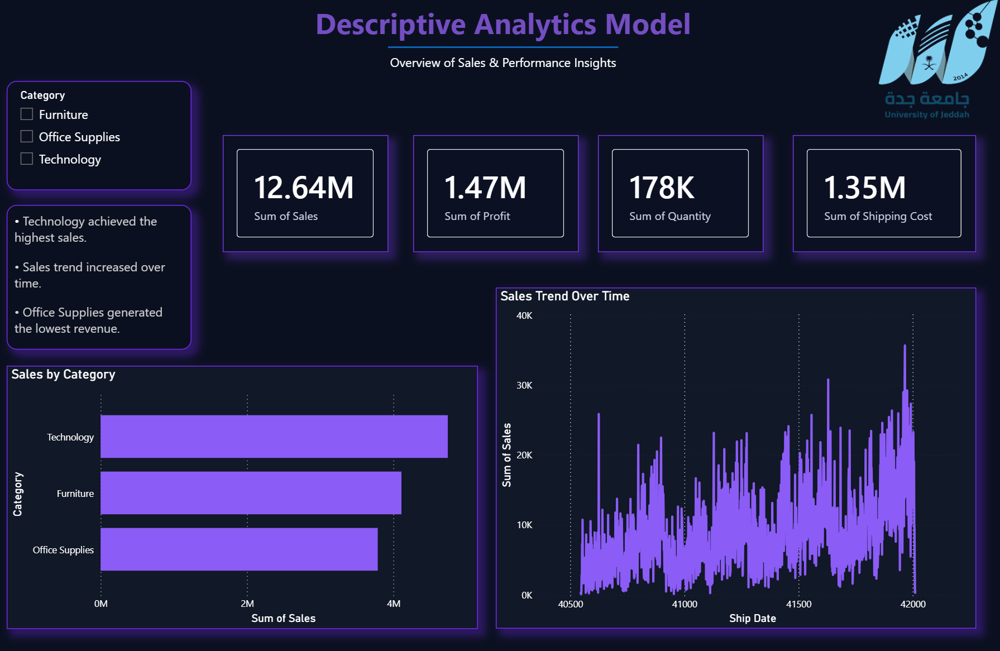
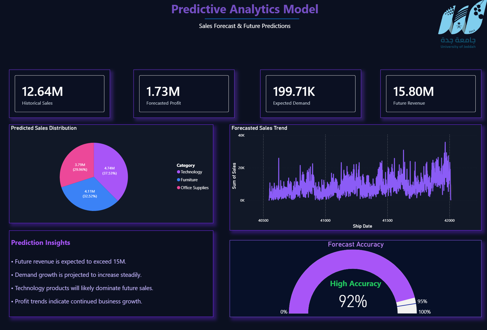
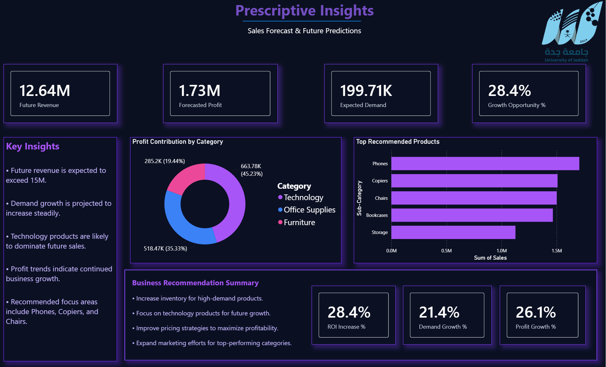

# Retail Sales Analytics – Power BI

## Project Overview

This academic group project focuses on analyzing retail sales data using Microsoft Power BI to support data-driven business decisions.

The project combines descriptive, predictive, and prescriptive analytics to understand sales performance, explore future trends, and provide business recommendations.

## 1. Descriptive Analytics Dashboard

### Key Features
- Analyzed historical sales, profit, and quantity sold.
- Compared sales performance across product categories.
- Visualized sales trends over time.
- Presented key performance indicators (KPIs).

## 2. Predictive Analytics Dashboard

### Key Features
- Presented forecasts for future sales and revenue.
- Analyzed expected demand and profit trends.
- Visualized sales predictions using interactive charts.
- Highlighted potential business growth opportunities.

## 3. Prescriptive Analytics Dashboard

### Key Features
- Provided recommendations for inventory management.
- Identified high-performing product categories.
- Presented pricing and growth recommendations.
- Supported data-driven business decision-making.

## Data Preprocessing

- Handled missing values and duplicate records.
- Standardized date formats and category labels.
- Applied feature engineering to prepare data for analysis.
- Created business metrics to support reporting.

## Tools & Technologies

- Microsoft Power BI
- Data Visualization
- Data Cleaning and Preprocessing
- Exploratory Data Analysis (EDA)
- Descriptive, Predictive, and Prescriptive Analytics

## Key Insights

- Technology products emerged as a major revenue contributor.
- Sales trends highlighted opportunities for future growth.
- Inventory and pricing recommendations were developed to support business decisions.
- Interactive dashboards helped transform sales data into actionable insights.

## Project Files

- [Retail-Sales-Analytics.pbix](Retail-Sales-Analytics.pbix) – Power BI project file.
- [Descriptive Dashboard](descriptive_Dashboard.png)
- [Predictive Dashboard](predictive_Dashboard.png)
- [Prescriptive Dashboard](prescriptive_Dashboard.png)

## How to View the Project

1. Download the PBIX file.
2. Open it using Microsoft Power BI Desktop.
3. Explore the three analytical dashboards.

## Project Information

Academic Group Project – University of Jeddah

**Ali H. Alzahrani**  
Data Science Student
